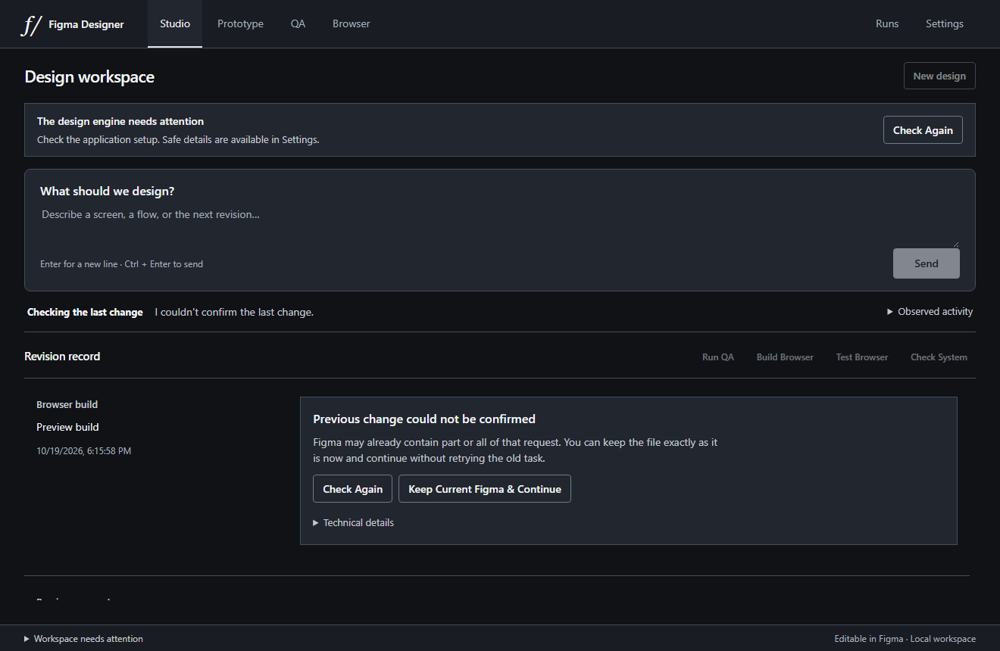
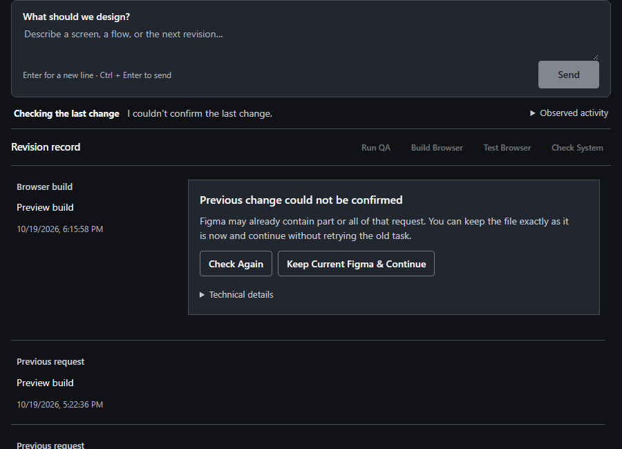
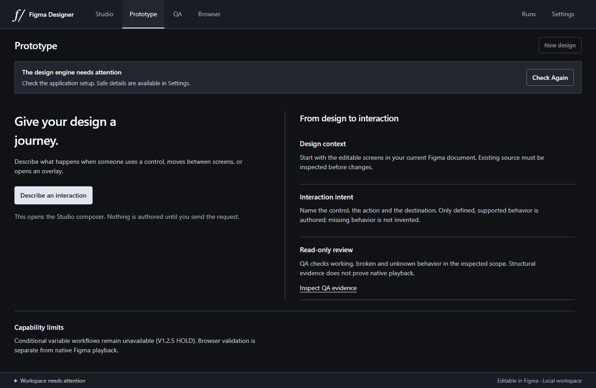
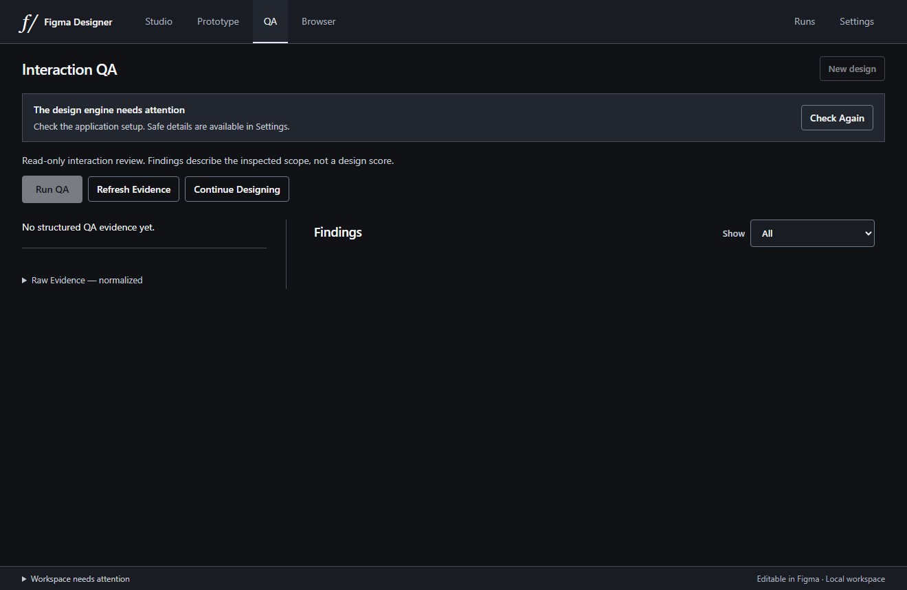
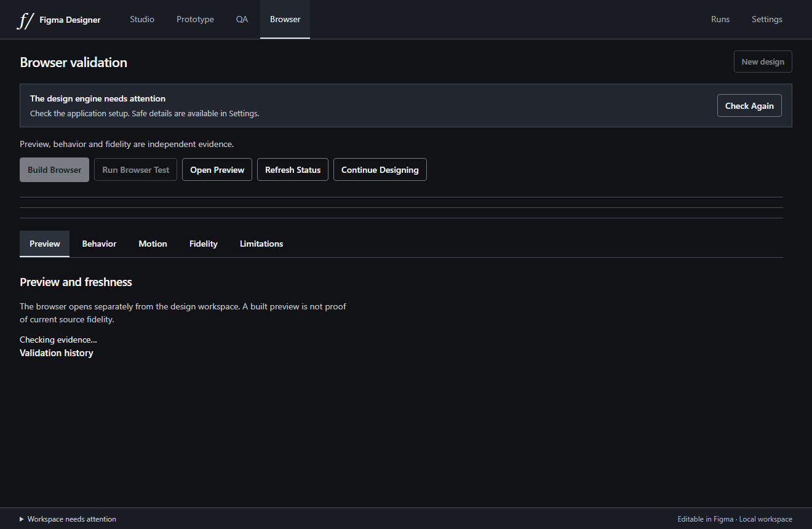
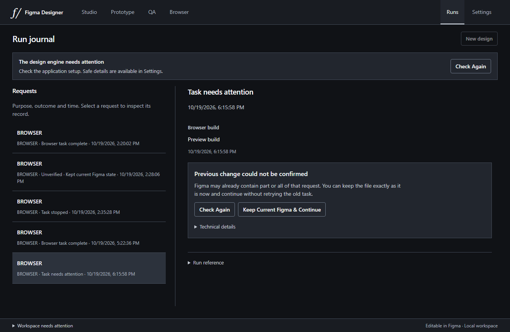
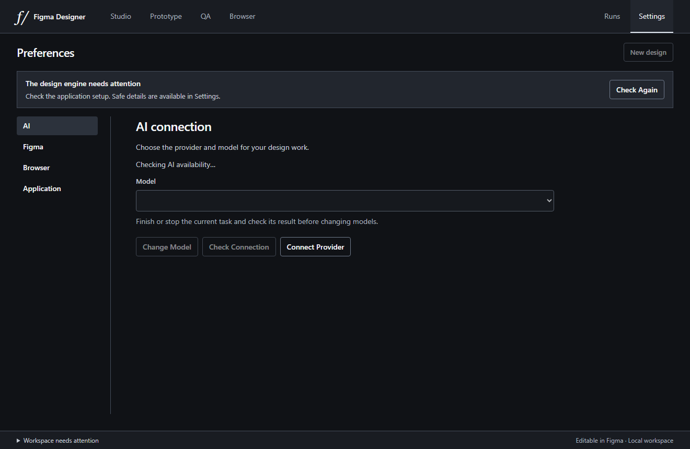
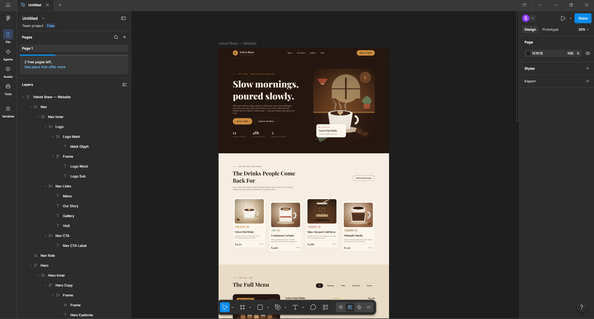

# Figma Designer

A Windows desktop AI design tool that creates editable native Figma interfaces from plain-language instructions. Describe what you want, revise it naturally, and use the prototype, QA, and browser validation workflows to check the result.

> **Public download: [v1.2.1-beta.4](https://github.com/Chammy01/figma-designer-standalone/releases/tag/v1.2.1-beta.4)** remains the recommended published prerelease. It is unsigned; Windows may show a SmartScreen/reputation warning. Beta 3 remains available as a rollback checkpoint.

## Current development preview

Current `main` contains the **unreleased V1.5.3 UI architecture rebuild** (Concept C: Design document), organized around a monochromatic graphite system. The desktop screenshots below show current development source, **not the Beta 4 download**. Beta 4 packages the earlier V1.4.4 desktop application; its published files are unchanged, and Beta 4 remains the recommended public release.



Studio places the composer above factual activity and a newest-first revision ledger. This 1320 × 860 source capture shows an existing unresolved change and an engine connection problem; it does not claim the previous task completed.

## From an idea to an editable interface

**Describe → Design → Review in Figma → Revise → Prototype → QA → Browser validation**

Start with the screen you need, its content, and the parts that matter most. Figma Designer creates native frames, text, components, and layers through the connected Figma Desktop plugin. You can edit them directly in Figma and ask for focused revisions that preserve the rest of the design.

For example, describe this in Studio:

```text
Design a project dashboard for a small creative team.
Include active projects, upcoming milestones, and recent activity.
Use a calm layout with clear typography. Make the next action easy to find.
```

A generated layout does not automatically make every control work. Add supported prototype interactions when needed, then inspect their behavior with QA before building and testing a browser preview.

### Capabilities

- Generate editable native Figma interfaces and make focused revisions.
- Create component states and native component-set variants.
- Connect screens and add supported prototype interactions and transitions.
- Run read-only QA with findings, limitations, and document-integrity evidence.
- Use **Browser Build** to generate a local preview, then **Browser Test** to check behavior, motion, source freshness, and fidelity separately.
- Follow agent activity and run status, revisit recent runs, and configure providers and models in the Windows desktop app.
- Check interrupted work before continuing. Recovery safeguards preserve uncertainty instead of blindly replaying a request.

## Inside the development workspace

The gallery shows the running V1.5.3 source interface with restored history. QA evidence is unverified against the current source, and the saved Browser evidence is stale. These images show how the app presents those limits; they do not certify completed design output or passing checks. Separately labeled state fixtures in the acceptance evidence exercise idle, working, waiting, completed, recovery and error presentation.

### Studio

<details>
<summary>Studio at compact desktop size (900 × 650)</summary>



At 900 × 650, the workspace uses natural document scrolling, keeps navigation labeled, and places the composer above the current request and recovery actions.

</details>

### Workflow and validation

<details>
<summary>Prototype planning surface</summary>



Prototype provides a three-stage sequence covering design context, user interaction intent, and read-only QA review without simulating unverified interactions.

</details>

<details>
<summary>QA review desk</summary>



QA places the verdict and document integrity beside the findings ledger. Coverage counts and raw evidence expand on demand.

</details>

<details>
<summary>Browser validation surface</summary>



Browser validation organizes Preview, Behavior, Motion, Fidelity, and Limitations into distinct chapters with persistent truth and guard status.

</details>

### Workspace management

<details>
<summary>Recent Runs</summary>



Recent Runs displays an indexed run history with intent summary, timing, and detailed outcome records.

</details>

<details>
<summary>Settings</summary>



Settings groups AI provider/model controls, Figma connection setup, browser-validation guidance and application information.

</details>

## Download and start Beta 4

The instructions here apply to the **published Beta 4 app**, whose interface differs from the development preview above.

1. Download **Figma-Designer-v1.2.1-beta.4-Windows-Setup.exe** from the [Beta 4 release assets](https://github.com/Chammy01/figma-designer-standalone/releases/tag/v1.2.1-beta.4) and install it for your user account.
2. Open Figma Desktop and a Design file, then launch **Figma Designer** from the Start Menu.
3. In **Settings → Figma Plugin Setup → Open Plugin Folder**, locate the manifest. In Figma, use **Plugins → Development → Import plugin from manifest**, then run **Figma Designer MCP** and keep it open.
4. Configure your AI provider/model if needed, then describe your interface in the app.

No terminal, npm, Go, Bun, or source checkout is required for normal desktop use. You need Figma Desktop, permission to import a development plugin, and internet/provider access.

The alternative **Figma-Designer-v1.2.1-beta.4-Windows-Portable.zip** must be fully extracted before opening **Figma Designer.exe**. Keep its files together. Install or extract Beta 4 separately; **do not merge it with Beta 3**. Close older OpenCode/MCP sessions and use the matching plugin from the Beta 4 folder. Installation roots currently have a 100-character limit.

See [Installation](docs/INSTALLATION.md), [Updating](docs/UPDATING.md), and the [Beta 4 release notes](docs/RELEASE_NOTES_v1.2.1-beta.4.md) for setup details and release-specific limitations.

## Editable Figma output



This earlier Velvet Brew example shows generated Figma output, not the V1.5.3 application shell. The frames, text, and layers remain editable. Historical terminal, setup, and plugin screenshots are preserved in [`docs/assets/`](docs/assets/) and explained in the [earlier README presentation record](docs/README_REVISION.md); their branding and runtime versions are not current setup guidance.

## How it works

The desktop app sends your request to OpenCode, which runs the Figma Designer workflows through the local MCP executable and localhost WebSocket bridge. The development plugin creates or edits native layers in the open Figma document. Browser generation and testing use local Node and Playwright, separate from Figma write operations.

See [Architecture](docs/ARCHITECTURE.md) for the integration details. OpenCode is the product runtime; you do not need its terminal interface for normal desktop use. Optional commands include `/figma/critique` | Review the current design and identify prioritized quality issues. Detailed slash workflows are documented in [Commands](docs/COMMANDS.md).

## Known limitations

- Current `main` is newer than the published Beta 4 download. The gallery captures show unreleased V1.5.3 development work.
- V1.2.5 stateful variables and conditionals remain **HOLD**. Supported prototype interactions do not imply unrestricted Figma conditionals.
- Native pixel/render parity remains **UNVERIFIED**. Browser validation does not certify perfect visual parity or every possible interaction.
- Existing development Browser findings include five MEDIUM stroke-width differences and a normal-motion intermediate-frame sample finding. They remain findings, not a passing fidelity/motion result.
- A prototype is not a production app. Authentication, persistent data, payments, and backend behavior require application code.
- AI provider access, model availability, output quality, usage limits, and costs are separate from this project. Windows x64 is the validated desktop platform.

See [Known limitations](docs/KNOWN_LIMITATIONS.md) for supported behavior and constraints. Browser Test protects the artifacts it checks; implementation details belong in the [V1.5.1 Browser Test artifact guard documentation](docs/BROWSER_TEST_ARTIFACT_GUARD_V1_5_1.md).

## Build and run current source

Git clones and GitHub source archives are developer installations. They require **Go 1.26.1 for Windows x64**, **Bun 1.4.2**, and the Node.js/npm/OpenCode prerequisites. From a checkout:

```powershell
powershell -NoProfile -ExecutionPolicy Bypass -File .\setup.ps1 -Configure -InstallDependencies -InstallBrowser
npm run app
```

Setup builds missing MCP and plugin runtime files from the pinned source and verifies their approved hashes. Existing approved runtime files are preserved. Generated binaries and plugin `dist` files are intentionally excluded from Git. Setup does not install Go or Bun.

`npm run app` opens the local source application service; `npm run desktop:prepare` followed by `npm run desktop` runs the desktop shell. See [Development](docs/DEVELOPMENT.md), [Source Bootstrap](docs/SOURCE_BOOTSTRAP.md), and [Release Packaging](docs/RELEASE_PACKAGING.md) for tool versions, tests, and build instructions. Legacy terminal installation is covered in [Quick Start](docs/QUICKSTART.md) and [Installation](docs/INSTALLATION.md).

## Documentation

- [Installation](docs/INSTALLATION.md) · [Troubleshooting](docs/TROUBLESHOOTING.md) · [Updating](docs/UPDATING.md)
- [Commands](docs/COMMANDS.md) · [Architecture](docs/ARCHITECTURE.md) · [Known limitations](docs/KNOWN_LIMITATIONS.md)
- V1.5.2: [UI audit](docs/MONOCHROMATIC_UI_AUDIT_V1_5_2.md) · [Design system](docs/MONOCHROMATIC_DESIGN_SYSTEM_V1_5_2.md) · [Overhaul architecture plan](docs/MONOCHROMATIC_UI_OVERHAUL_V1_5_2.md)
- [Beta 4 desktop architecture and acceptance](docs/FIGMA_DESIGNER_DESKTOP_V1_4_4.md) · [Changelog](CHANGELOG.md)
- [Security](SECURITY.md) · [Contributing](CONTRIBUTING.md) · [Third-party notices](THIRD_PARTY_LICENSES.md)

## License

Project-owned code and documentation use the [MIT License](LICENSE). Dependencies and bundled third-party material retain their own licenses and notices.
